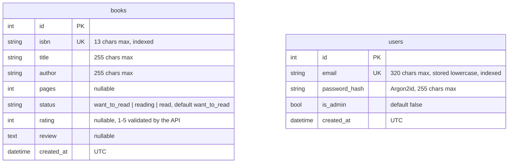

# Entity-relationship diagram

`Book` is a shared catalog entry (ADR 0002); `status`, `rating` and `review` move to per-user tables later in stage 3. `users` is not yet related to `books`; the shelf table will link them.

